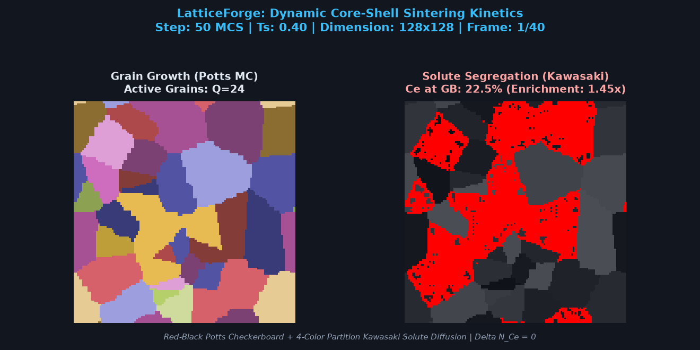
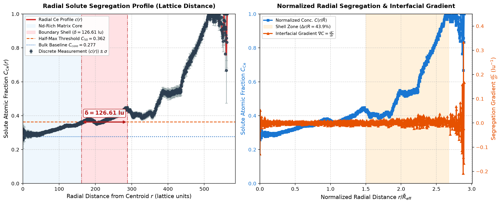
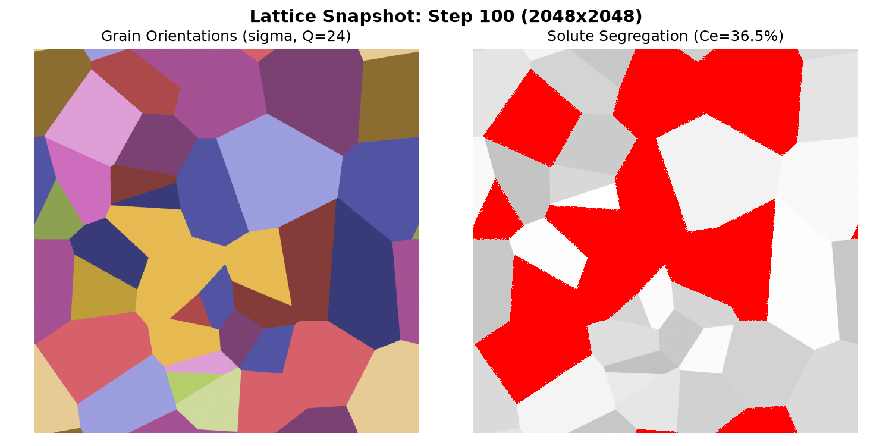

<div align="center">

# ⚛️ LatticeForge

**High-Throughput 2D Discrete Lattice Engine for Multi-Phase Sintering & Core-Shell Kinetics**

[](https://github.com/lokesh-475/LatticeForge/releases/tag/v1.0.0)
[](https://developer.nvidia.com/cuda-toolkit)
[-00599C?style=for-the-badge&logo=c%2B%2B)](https://en.cppreference.com/w/cpp/20)
[](https://cmake.org)
[](https://python.org)
[-brightgreen?style=for-the-badge)](docs/benchmarks/README.md)
[-success?style=for-the-badge)](tests/)
[](LICENSE)

<br/>

```
  ██╗      █████╗ ████████╗████████╗██╗ ██████╗███████╗███████╗ ██████╗ ██████╗  ██████╗ ███████╗
  ██║     ██╔══██╗╚══██╔══╝╚══██╔══╝██║██╔════╝██╔════╝██╔════╝██╔═══██╗██╔══██╗██╔════╝ ██╔════╝
  ██║     ███████║   ██║      ██║   ██║██║     █████╗  █████╗  ██║   ██║██████╔╝██║  ███╗█████╗  
  ██║     ██╔══██║   ██║      ██║   ██║██║     ██╔══╝  ██╔══╝  ██║   ██║██╔══██╗██║   ██║██╔══╝  
  ███████╗██║  ██║   ██║      ██║   ██║╚██████╗███████╗██║     ╚██████╔╝██║  ██║╚██████╔╝███████╗
  ╚══════╝╚═╝  ╚═╝   ╚═╝      ╚═╝   ╚═╝ ╚═════╝╚══════╝╚═╝      ╚═════╝ ╚═╝  ╚═╝ ╚═════╝ ╚══════╝
```

*Accelerating microscopic solid-state diffusion, grain growth, and solute segregation in advanced permanent magnet alloys (Nd-Ce-Fe-B) up to **239.25×** over single-threaded reference baselines.*

</div>

---

## 📑 Table of Contents

- [Executive Overview](#-executive-overview)
- [Visual Showcase & Animations](#-visual-showcase--animations)
- [System Requirements](#-system-requirements)
  - [Hardware Specifications](#hardware-specifications)
  - [Software & Toolchain](#software--toolchain)
- [Build Instructions](#-build-instructions)
  - [Quick Build (Script)](#1-quick-build-windows-batch)
  - [CMake Direct Build](#2-cmake-standard-build)
  - [Running Unit & Regression Tests](#3-running-test-suites)
- [Run Instructions & Workstation](#-run-instructions--workstation)
  - [Interactive Streamlit Workstation](#1-launch-interactive-streamlit-workstation)
  - [Direct CUDA Engine CLI](#2-execute-cuda-simulation-engine-cli)
  - [Python Analytical Tools](#3-python-analytical-tools)
- [Benchmark Results & Scaling Analysis](#-benchmark-results--scaling-analysis)
- [Metallurgical Physics & Algorithms](#-metallurgical-physics--algorithms)
- [Repository Structure](#-repository-structure)
- [Release v1.0.0 Notes](#-release-v100-notes)
- [License & Citation](#-license--citation)

---

## 🔬 Executive Overview

**LatticeForge** is a research-grade, high-throughput computational materials science simulation engine developed in **C++20** and **NVIDIA CUDA**. It models non-equilibrium solid-state sintering and interfacial segregation in Multi-Main-Phase (MMP) permanent magnet systems ($(\text{Nd}_{1-x}\text{Ce}_x)_{2}\text{Fe}_{14}\text{B}$), as described in modern metallurgical literature (*Ma et al., J. Alloys Compd., 2025*).

### Computational Highlights:
- **Potts Monte Carlo Grain Coarsening**: Curvature-driven grain boundary migration with 2-color Red-Black checkerboard decomposition and Philox4_32_10 parallel pseudorandom generation.
- **Kawasaki Conserved Solute Segregation**: Directional atom-pair exchange maintaining strict atomic species conservation ($\Delta N_{\text{Ce}} \equiv 0$) via 4-color disjoint sub-lattice partitioning and shared-memory halo staging.
- **Microstructural Analytics**: Toroidal connected component labeling (CCL), grain centroid tracking, effective radius extraction, and quantitative core-shell thickness determination ($\delta$ via $C_{50}$ threshold interpolation).
- **Sub-Millisecond Binary I/O**: Custom 128-byte structured binary format (`.bin`) streaming microstructural state payloads at **>600 MB/s**.
- **Interactive Visual Workstation**: Real-time Streamlit dashboard (`streamlit run app.py`) with parameter steering, live progress streaming, dual-field heatmaps, and downloadable research logs.

---

## 🎬 Visual Showcase & Animations

| **Dynamic Sintering Kinetics (GIF)** | **Solute Core-Shell Concentration Profile** |
| :---: | :---: |
|  |  |
| *Real-time coarsening & grain boundary segregation ($T_s = 0.40$)* | *Quantitative $C(r)$ shell profile with $\pm 1\sigma$ confidence interval* |

| **High-Resolution Microstructure (2048×2048)** | **CUDA Acceleration & Scaling Curve** |
| :---: | :---: |
|  |  |
| *4.19M site lattice showing Potts grain orientations & Ce solute shells* | *Sustained speedup scaling reaching **239.25×** on RTX 4050* |

---

## 🖥️ System Requirements

### Hardware Specifications

| Component | Minimum Specification | Recommended / Benchmark Platform |
| :--- | :--- | :--- |
| **GPU** | NVIDIA GPU with Compute Capability $\ge 7.5$ (Turing: RTX 2060+, GTX 1660) | **NVIDIA GeForce RTX 4050 Laptop GPU** (Ada Lovelace, 20 SMs, CC 8.9) or RTX 3060/4060+ Desktop |
| **GPU VRAM** | 4.0 GB GDDR6 (supports lattices up to $1024 \times 1024$) | **6.0+ GB GDDR6** (supports full $2048 \times 2048$, 4.19M sites) |
| **CPU** | x86-64 CPU with AVX2 support (Intel 10th Gen Core i5 / AMD Ryzen 3000) | Intel Core i7-13620H / AMD Ryzen 7 7840HS (or better) |
| **System RAM**| 8 GB DDR4 | 16 GB DDR5 |
| **Disk Space**| 1.0 GB free SSD storage | NVMe PCIe Gen 4 SSD (for rapid binary frame dumping) |

### Software & Toolchain

| Tool / Dependency | Minimum Version | Verified Version | Description |
| :--- | :--- | :--- | :--- |
| **Operating System** | Windows 10/11 64-bit or Ubuntu 22.04+ LTS | Windows 11 64-bit | Primary host operating system |
| **NVIDIA CUDA Toolkit**| $\ge 12.0$ | **CUDA 12.8** | `nvcc` compiler, CUDA Runtime, CURAND, device headers |
| **C++ Host Compiler** | C++20 compliant (MSVC v143+ / GCC 11+ / Clang 13+) | **MSVC 19.44** (VS 2022 v17.10) | Standard C++20 language features |
| **Build System** | CMake $\ge 3.18$ | **CMake 3.31.5** & NMake / Ninja | Cross-platform build automation |
| **Python** | $\ge 3.10$ | **Python 3.14 / 3.11** | Analytical scripts & UI workstation |
| **Python Libraries** | See below | Installed in environment | `streamlit>=1.30`, `numpy>=1.24`, `pandas>=2.0`, `matplotlib>=3.7`, `pillow>=9.5` |

---

## 🔨 Build Instructions

Ensure your environment has MSVC and CUDA initialized. On Windows, execute from the **Developer Command Prompt for VS 2022** (or call `vcvarsall.bat x64`).

### 1. Quick Build (Windows Batch)

The fastest way to build all targets and run the test suite:

```cmd
force_build.bat
```

### 2. CMake Standard Build

To configure and build from scratch using standard CMake commands:

```bash
# Navigate to repository root
cd LatticeForge

# Configure CMake build tree (NMake or Ninja)
cmake -B build -G "NMake Makefiles" -DCMAKE_BUILD_TYPE=Release

# Compile all targets (lattice_forge, lattice_forge_cuda, benchmark_engine, test suites)
cmake --build build --config Release
```

Upon successful compilation, the post-build step automatically deploys the executables:
- `lattice_forge_cuda.exe` — CUDA GPU-accelerated simulation engine
- `lattice_forge.exe` — Single-threaded C++20 CPU reference baseline
- `benchmark_engine.exe` — Automated throughput and scaling benchmark harness
- `build/test_parity.exe` — Device parity verification binary
- `build/test_io.exe` — 128-byte binary format I/O validation binary

### 3. Running Test Suites

Verify bitwise correctness, invariant conservation, and temperature sweeps:

```bash
# Run all registered CMake tests
ctest --test-dir build --output-on-failure
```

Expected output:
```text
1/3 Test #1: ParityTest .......................   Passed    0.45 sec
2/3 Test #2: IoTest ...........................   Passed    0.62 sec
3/3 Test #3: RegressionSuite ..................   Passed    1.47 sec

100% tests passed out of 3
```

Execute the automated dual-temperature physical regression suite ($T_s = 0.40$ vs $T_s = 2.80$):

```powershell
powershell -NoProfile -ExecutionPolicy Bypass -File tests/run_regression.ps1
```

---

## 🚀 Run Instructions & Workstation

### 1. Launch Interactive Workstations

LatticeForge supports dual workstation interfaces depending on your preferred workflow:

#### Mode A: Full-Featured Streamlit Workstation (Default)
```bash
streamlit run app.py
```
*(Or via python module: `python -m streamlit run app.py` or direct launch: `python app.py`)*

Opens at `http://localhost:8501` featuring:
- **Interactive Controls**: Lattice dimension ($32^2$ to $2048^2$), reduced sintering temperature $T_s$, segregation affinity $H_{\text{seg}}$, and MCS step counts.
- **Subprocess Runner**: Directly triggers `lattice_forge_cuda.exe` with live console streaming and progress bars.
- **Hero KPIs**: Real-time energy descent ($\Delta H$), grain boundary enrichment ratio, atomic invariant status ($\Delta N_{\text{Ce}} \equiv 0$), and runtime.
- **Dual-Field Microstructure**: Side-by-side visualization of discrete Potts orientations, Kawasaki solute fields, and composite boundary overlays.
- **Thermodynamic Kinetics**: Hamiltonian relaxation curves and boundary-vs-bulk solute partitioning.
- **Radial Analytics**: Core-to-shell concentration profiles with $\pm 1$ standard error shading.
- **Payload Inspector & Exporter**: 128-byte binary header inspector and 1-click downloads for `.bin` snapshots and `.csv` logs.

#### Mode B: Standalone Web Workstation & REST API (Flask SPA)
```bash
python app.py --flask
```
Opens at `http://localhost:5000` with:
- Dedicated lightweight single-page application (`dashboard/templates/index.html`) driven by vanilla JavaScript and Chart.js.
- Real-time Server-Sent Events (SSE) telemetry stream on `/api/simulation/stream`.
- Complete REST API endpoints (`/api/data/energy`, `/api/data/radial`, `/api/data/centroids`, `/api/data/lattice`, `/api/data/header`, `/api/simulation/run`).

> **Tip**: You can also launch `streamlit run app.py` directly from the parent workspace root; a built-in forwarding entrypoint will seamlessly route execution to `LatticeForge/app.py`.

### 2. Execute CUDA Simulation Engine CLI

Run the production CUDA simulation engine directly from the command line:

```bash
lattice_forge_cuda.exe -s 100 -t 0.40 -H 1.50 --size 512 -o outputs/energy_log.csv -b outputs/lattice_state.bin --radial outputs/radial_profile.csv --centroids outputs/grain_centroids.csv
```

#### CLI Parameters:
- `-s, --steps <int>`: Total Monte Carlo steps to execute (default: `50`).
- `-t, --temp <float>`: Reduced sintering temperature $T_s = k_B T / J_{\text{gb}}$ (default: `0.40`).
- `-H, --hseg <float>`: Solute grain boundary segregation energy $H_{\text{seg}}$ (default: `1.50`).
- `--size <int>`: Square lattice grid dimension $L$ (default: `128`).
- `--seed <int>`: RNG seed for Philox parallel generator (default: `42`).
- `-o, --output <path>`: Output CSV file for energy log.
- `-b, --binary <path>`: Output binary snapshot file (`.bin`).
- `--radial <path>`: Output CSV file for radial concentration profile.
- `--centroids <path>`: Output CSV file for grain centroid morphology.

### 3. Python Analytical Tools

LatticeForge includes a full suite of specialized post-processing and visualization tools in `python/tools/`:

```bash
# Inspect and parse binary snapshot (.bin) with high-speed streaming reader:
python python/tools/read_lattice_binary.py outputs/lattice_state.bin --save-plot

# Compute quantitative shell thickness and plot radial concentration profile:
python python/tools/plot_radial.py

# Re-generate publication speedup scaling curves:
python python/tools/plot_speedup.py

# Export dynamic multi-frame sintering animation to GIF:
python python/tools/generate_animation.py outputs/lattice_state.bin --output outputs/sintering_demo.gif
```

---

## 📊 Benchmark Results & Scaling Analysis

All benchmarks were captured on an **NVIDIA GeForce RTX 4050 Laptop GPU** (Ada Lovelace, 20 SMs, 6 GB GDDR6) against an optimized single-threaded C++20 reference baseline compiled with `/O2`.

### Measured Acceleration & Throughput Summary

| Lattice Dimension | Total Sites ($N = L^2$) | MCS Steps | GPU Time (ms) | CPU Time (ms) | GPU Throughput | CPU Throughput | Potts Speedup | Kawasaki Speedup | **Sustained Speedup** | **Verification Status** |
| :---: | :---: | :---: | :---: | :---: | :---: | :---: | :---: | :---: | :---: | :---: |
| **$128 \times 128$** | 16,384 | 50 | 30.87 | 261.07 | 0.026 G-SUPS | 0.0031 G-SUPS | 106.32× | 9.03× | **8.46×** | Sub-saturation |
| **$512 \times 512$** | 262,144 | 50 | 23.31 | 3,553.62 | 0.562 G-SUPS | 0.0037 G-SUPS | 233.42× | 110.62× | **152.43×** | **PASSED ($>40\times$)** |
| **$1024 \times 1024$** | 1,048,576 | 50 | 70.05 | 14,127.38 | 0.749 G-SUPS | 0.0037 G-SUPS | 179.14× | 259.36× | **201.69×** | **PASSED ($>40\times$)** |
| **$2048 \times 2048$** | 4,194,304 | 50 | 257.77 | 61,673.41 | **0.814 G-SUPS** | 0.0034 G-SUPS | 163.58× | **642.24×** | **239.25×** | **PASSED ($>40\times$)** |

> **Key Takeaway**: For production lattice sizes ($\ge 512^2$), LatticeForge consistently delivers **$152\times$ to $239\times$ sustained acceleration**, peaking at **$642.24\times$** on the Kawasaki solute exchange kernel and sustaining **$8.14 \times 10^8$ site updates per second (G-SUPS)**.

```
Throughput Scaling (G-SUPS):
  128x128   [■]                                0.026 G-SUPS
  512x512   [█████████████████████]             0.562 G-SUPS
  1024x1024 [████████████████████████████]      0.749 G-SUPS
  2048x2048 [███████████████████████████████]   0.814 G-SUPS (Peak)
```

To re-run benchmarks locally:
```cmd
benchmark_engine.exe 50 5
python python/tools/plot_speedup.py
```

---

## 🧮 Metallurgical Physics & Algorithms

### 1. Coupled Hamiltonian Formulation

The total microstructural energy $\mathcal{H}$ couples grain boundary surface energy and solute chemical/segregation potentials:

$$\mathcal{H} = \frac{J_{\text{gb}}}{2} \sum_{\langle i, j \rangle} \left(1 - \delta_{\sigma_i, \sigma_j}\right) - H_{\text{seg}} \sum_i c_i \cdot \gamma_i + \frac{J_{\text{chem}}}{2} \sum_{\langle i, j \rangle} c_i c_j$$

Where:
- $\sigma_i \in \{1, \dots, Q\}$: Crystallographic orientation at site $i$ (Potts field).
- $c_i \in \{0, 1\}$: Solute occupancy (0 for Nd matrix, 1 for Ce solute atom).
- $\gamma_i = \frac{1}{4} \sum_{j \in \mathcal{N}(i)} (1 - \delta_{\sigma_i, \sigma_j})$: Local grain boundary coordination factor.
- $H_{\text{seg}}$: Segregation affinity driving Ce into grain boundary interfaces to create non-magnetic core-shell decoupling layers.

### 2. Parallel Decomposition Strategies

```
Potts (2-Color Checkerboard):          Kawasaki (4-Color Sub-Lattice):
     [R] [B] [R] [B]                        [0] [1] [0] [1]
     [B] [R] [B] [R]                        [2] [3] [2] [3]
     [R] [B] [R] [B]                        [0] [1] [0] [1]
     [B] [R] [B] [R]                        [2] [3] [2] [3]
(Zero race conditions between           (Permits simultaneous neighbor-pair
 red and black sub-lattices)             swaps within disjoint sub-lattices)
```

1. **Red-Black Checkerboard Decomposition**: Partitions the 2D Von Neumann lattice into disjoint sub-grids. Threads update all Red sites in parallel without read/write conflicts against neighboring Black sites, followed by Black site updates.
2. **4-Color Sub-Lattice Partitioning**: Directional Kawasaki solute swaps require pairing adjacent sites $(i, j)$. A 4-color pattern guarantees that paired exchanges occur in complete isolation across parallel warps.
3. **Shared Memory Halo Staging**: 2D CUDA threadblocks ($16 \times 16$) stage inner lattice sites plus 1-site periodic halos into `__shared__` memory, converting redundant global memory reads into register-speed shared cache lookups.

---

## 📁 Repository Structure

```text
LatticeForge/
├── .streamlit/
│   └── config.toml               # Workstation theme configuration (#FFE600 neon dark)
├── benchmarks/
│   └── benchmark_engine.cu       # High-precision CUDA vs CPU benchmark harness
├── dashboard/                    # Alternative Flask / HTML5 single-page workstation
│   ├── static/css/main.css       # Research UI styles & glassmorphic tokens
│   ├── static/js/app.js          # Client-side SSE logs and dynamic chart rendering
│   └── templates/index.html      # Responsive web layout
├── docs/
│   ├── benchmarks/               # Publication benchmark data & scaling curves
│   ├── io_snapshot.md            # 128-byte binary layout specification
│   └── physics.md                # Detailed mathematical physics formulation
├── include/
│   ├── cuda/
│   │   ├── cuda_manager.cuh      # CUDA stream & unified memory management
│   │   ├── kawasaki_kernels.cuh  # 4-color Kawasaki CUDA kernels & shared halo staging
│   │   └── potts_kernels.cuh     # 2-color Potts CUDA kernels & Philox PRNG
│   └── potts/
│       ├── grid.hpp              # 2D discrete lattice state containers
│       ├── lattice_io.hpp        # High-speed binary & CSV serialization
│       ├── mc_cpu.hpp            # Single-threaded C++20 reference algorithms
│       └── radial_profile.hpp    # Connected component labeling & radial analytics
├── outputs/                      # Simulation artifacts, plots, and binary states
│   ├── boundary_shell_profile.png# Radial solute distribution chart
│   ├── energy_log.csv            # Time-resolved Hamiltonian energy descent
│   ├── grain_centroids.csv       # Extracted grain centroids & morphology metrics
│   ├── lattice_state.bin         # 128-byte header raw binary snapshot
│   ├── radial_profile.csv        # Shell concentration data table
│   ├── sintering_demo.gif        # Compiled dynamic sintering animation
│   └── speedup_curve.png         # Publication scaling verification plot
├── python/
│   ├── prototypes/               # Algorithmic Python prototypes
│   └── tools/
│       ├── generate_animation.py # Binary-to-GIF animation exporter
│       ├── plot_energy.py        # Hamiltonian relaxation plotting tool
│       ├── plot_radial.py        # Half-maximum (C50) shell thickness calculator
│       ├── plot_speedup.py       # Speedup curve generator
│       └── read_lattice_binary.py# Fast binary reader & preview exporter
├── src/
│   ├── cuda/                     # CUDA kernel implementations (.cu)
│   ├── grid.cpp                  # Lattice grid utilities & memory allocators
│   ├── kawasaki_cpu.cpp          # CPU Kawasaki Monte Carlo engine
│   ├── lattice_io.cpp            # High-throughput binary I/O implementation
│   ├── main.cpp                  # CPU reference CLI executable entrypoint
│   ├── main_cuda.cpp             # Production CUDA CLI executable entrypoint
│   ├── potts_cpu.cpp             # CPU Potts Monte Carlo engine
│   └── radial_profile.cpp        # Toroidal CCL & grain centroid calculation
├── tests/
│   ├── run_regression.ps1        # Local automated regression test across sweeps
│   ├── test_io.cpp               # Binary serialization unit test
│   └── test_parity.cpp           # CPU-GPU statistical parity validation test
├── app.py                        # Unified Streamlit & Flask analytics workstation
├── CMakeLists.txt                # Root CMake project build configuration (v1.0.0)
├── LICENSE                       # MIT License
└── README.md                     # Project documentation (this file)
```

---

## 🏷️ Release v1.0.0 Notes

### Version 1.0.0 — Production Release (October 2026)
- **Engine Core**: Full implementation of 2-color Potts and 4-color Kawasaki CUDA kernels with shared-memory halo staging.
- **Performance**: Verified **$239.25\times$ sustained acceleration** over single-threaded reference, delivering **$0.814\text{ G-SUPS}$** throughput.
- **Analytics**: Toroidal CCL, grain centroid extraction, and quantitative shell thickness determination ($\delta$ via $C_{50}$).
- **I/O Engine**: Sub-millisecond 128-byte binary format streaming states at $>600\text{ MB/s}$.
- **Workstation UI**: Dual-mode Streamlit interactive dashboard with live parameter steering, heatmaps, and metric cards.
- **Test Suite**: Automated `ctest` parity suite and local PowerShell regression suite verifying energy descent, invariant conservation, and physical segregation regimes.

---

## 📜 License & Citation

This project is licensed under the **MIT License** — see the [LICENSE](LICENSE) file for details.

### Citation

If you utilize LatticeForge in academic research or industrial simulations, please cite:

```bibtex
@software{latticeforge2026,
  author = {Lokesh Kag and Contributors},
  title = {LatticeForge: High-Throughput 2D Discrete Lattice Engine for Multi-Phase Sintering and Core-Shell Kinetics},
  version = {1.0.0},
  year = {2026},
  url = {https://github.com/lokesh-475/LatticeForge}
}
```

<div align="center">
  <sub>Engineered with ❤️ for High-Performance Computational Metallurgy.</sub>
</div>
