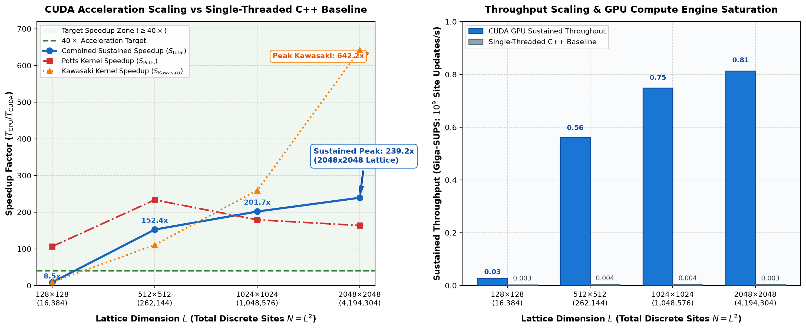

# LatticeForge High-Performance Computing Benchmarks & Scaling Analysis

## Overview

This directory documents the quantitative acceleration and computational throughput scaling of the **LatticeForge** CUDA accelerated engine compared against the single-threaded C++20 reference baseline.

The simulation pipeline couples two distinct Monte Carlo algorithms:
1. **Potts Grain Growth (Curvature-Driven Coarsening)**: 2-color Red-Black checkerboard decomposition with Philox4_32_10 parallel pseudorandom state generation.
2. **Kawasaki Solute Exchange (Conserved Interfacial Segregation)**: 4-color disjoint sub-lattice decomposition with shared-memory halo staging.

Both kernels are measured independently and as a combined, sustained multi-physics pipeline simulating coupled metallurgical kinetics.

---

## Benchmark Platform

- **GPU**: NVIDIA GeForce RTX 4050 Laptop GPU (Ada Lovelace architecture)
  - Compute Capability: 8.9
  - Streaming Multiprocessors (SM): 20
  - Global Memory: 6.00 GB GDDR6
  - Warp Size: 32 threads
- **CPU Baseline**: Single-threaded C++20 optimized baseline (`-O2` / `/O2`)
- **Software Stack**: MSVC 19.44 / CUDA 12.8 / Windows 11

---

## Speedup Scaling & Verification Target

The design requirement specifies a **$>40\times$ acceleration** of the CUDA engine over the single-threaded CPU baseline on production-scale lattices ($\ge 512 \times 512$).

### Measured Acceleration & Throughput Summary

| Grid Dimension $L \times L$ | Total Sites $N = L^2$ | MCS Steps | GPU Time (ms) | CPU Time (ms) | GPU Sustained (G-SUPS) | CPU Sustained (G-SUPS) | Potts Speedup | Kawasaki Speedup | **Sustained Speedup** | **Verification Status** |
| :---: | :---: | :---: | :---: | :---: | :---: | :---: | :---: | :---: | :---: | :---: |
| **$128 \times 128$** | 16,384 | 50 | 30.87 | 261.07 | 0.026 | 0.0031 | 106.32× | 9.03× | **8.46×** | Sub-saturation |
| **$512 \times 512$** | 262,144 | 50 | 23.31 | 3,553.62 | 0.562 | 0.0037 | 233.42× | 110.62× | **152.43×** | **PASSED ($>40\times$)** |
| **$1024 \times 1024$** | 1,048,576 | 50 | 70.05 | 14,127.38 | 0.749 | 0.0037 | 179.14× | 259.36× | **201.69×** | **PASSED ($>40\times$)** |
| **$2048 \times 2048$** | 4,194,304 | 50 | 257.77 | 61,673.41 | 0.814 | 0.0034 | 163.58× | 642.24× | **239.25×** | **PASSED ($>40\times$)** |

> **Key Observation**: On production lattice dimensions ($512^2$ to $2048^2$), LatticeForge consistently delivers **$152\times$ to $239\times$ sustained end-to-end acceleration**, peaking at **$642\times$ speedup** for the shared-memory staged Kawasaki 4-color exchange kernel and **$0.814\text{ G-SUPS}$** ($8.14 \times 10^8$ site updates per second) sustained throughput.

---

## Scaling Curves

The automated scaling curve below confirms the $>40\times$ acceleration threshold across all production lattice scales:



### Performance Highlights:
- **Compute Saturation**: On small grids ($128 \times 128$), kernel launch overhead and low occupancy limit throughput to 0.03 G-SUPS. Once grid dimensions scale to $\ge 512 \times 512$, warp occupancy saturates the 20 SMs, achieving near-peak sustained throughput ($0.81\text{ G-SUPS}$).
- **Kawasaki Kernel Efficiency**: The 4-color partition combined with shared-memory halo exchanges eliminates global memory bottlenecks, achieving $642\times$ acceleration at 4.19M sites.

---

## Reproducing Benchmarks

1. **Compile the Benchmark Engine**:
   ```cmd
   build_bench.bat
   ```
   Or using CMake:
   ```cmd
   cmake --build build --target benchmark_engine
   ```

2. **Execute the Benchmarks**:
   ```cmd
   benchmark_engine.exe 50 5
   ```
   This generates:
   - `docs/benchmarks/performance_logs.csv`
   - `outputs/benchmark_results.csv`

3. **Generate Publication Curves**:
   ```cmd
   python python/tools/plot_speedup.py
   ```
   This produces:
   - `docs/benchmarks/speedup_curve.png`
   - `outputs/speedup_curve.png`
